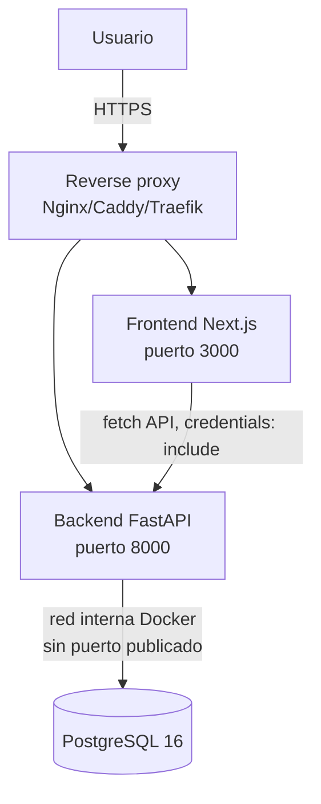
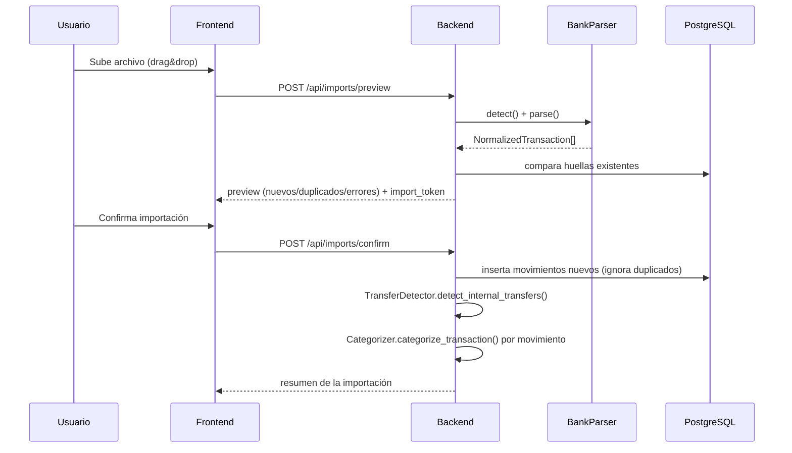
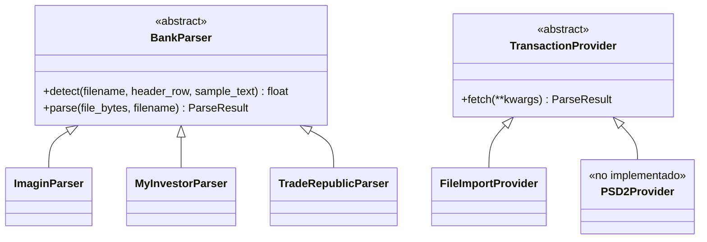
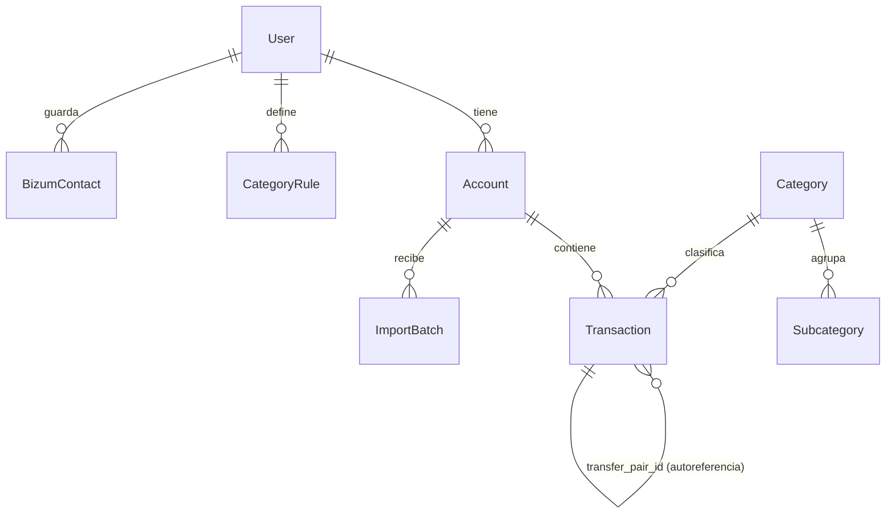

# Arquitectura

## 1. Visión general del despliegue

`docker-compose.yml` define dos redes: `finapp_public` (frontend y backend)
y `finapp_internal` (backend y base de datos, `internal: true`, sin salida
a Internet ni acceso desde el host).

## 2. Flujo de importación

## 3. Interfaces extensibles

El núcleo de la aplicación nunca depende de un banco concreto: todo pasa
por interfaces (`app/parsers/base.py`, `app/services/*.py`).

Añadir un nuevo banco = crear una clase que implemente `BankParser` y
registrarla en `app/parsers/registry.py`. Nada más del sistema cambia.

Añadir Open Banking/PSD2 en el futuro = implementar `PSD2Provider.fetch()`
usando un agregador licenciado; el resto del pipeline (normalización,
deduplicación, categorización, analítica) es idéntico porque todos
consumen `NormalizedTransaction`, no el formato original del banco.

## 4. Modelo de datos (resumen)

Ver `backend/app/models.py` para el detalle completo de columnas.

## 5. Reglas de cálculo financiero (sección 47 del spec original)

Implementadas en `backend/app/services/analytics_engine.py`:

- **Ingresos** = suma de `amount > 0`, excluyendo transferencias internas.
- **Gastos** = suma de `amount < 0`, excluyendo transferencias internas
  y excluyendo compras de inversión (`INVESTMENT_BUY`).
- **Ahorro** = Ingresos − Gastos.
- **Inversión** = suma de movimientos `INVESTMENT_BUY` (valor absoluto).

Todos los importes se almacenan como `NUMERIC(14,2)` en PostgreSQL y se
manipulan como `Decimal` en Python — nunca `float` — para evitar errores
de redondeo en cifras financieras.

## 6. Deduplicación

`backend/app/services/dedup.py`: huella SHA-256 de
`cuenta + fecha + importe + descripción normalizada + moneda`, o del
`external_id` cuando el archivo lo proporciona. Restricción `UNIQUE` en
base de datos (`uq_transaction_fingerprint`) como segunda barrera además
de la comprobación explícita antes de insertar.
